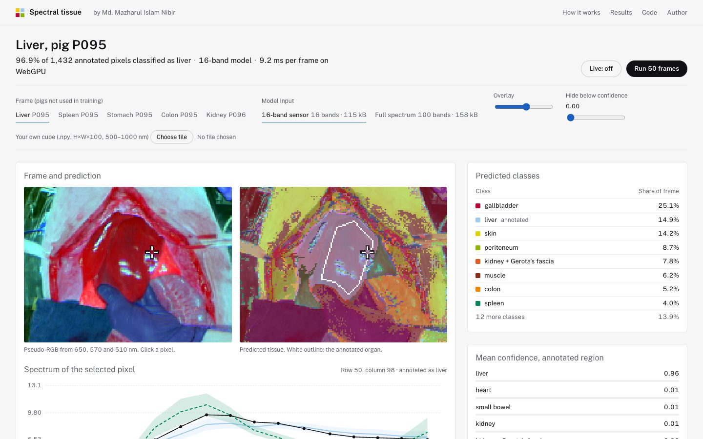

# Real-time-oriented tissue classification on surgical hyperspectral images

**Live demo (runs in your browser): <https://hyperspectral-imaging-tissue-segmen.vercel.app/>**

Hyperspectral cameras record about 100 wavelengths per pixel, and tissue types differ in how they
reflect that light. This project trains small models to classify **20 porcine organs pixel by pixel**
from the public HeiPorSPECTRAL dataset. It asks one practical question: **how much accuracy is lost
when the full 100-band spectrum is replaced by the 16 bands a video-rate snapshot mosaic sensor
captures?** Three model families were trained with three seeds each and evaluated on **pigs never seen
in training**. The models were exported to ONNX, benchmarked on a laptop, and deployed as a website
where inference runs in the visitor's browser (WebGPU or WebAssembly).

[](https://hyperspectral-imaging-tissue-segmen.vercel.app/)

<!-- GIF placeholder: record a short screen capture of the live demo (switch frames, toggle 16-band /
full, click pixels, press "Live"), save it as docs/demo.gif and replace the screenshot above. -->

## Results

Test set: 2 pigs (P095, P096), 128 images, never used for training or model selection. Metrics are
computed on annotated pixels only. Values are mean ± sd over 3 seeds. Latency is batch 1, one
240 × 320 frame, ONNX Runtime CPU on an Apple M3 Pro, model only.

| Model | Bands | Test macro F1 | Image-level accuracy | Params | ONNX file | CPU latency |
|---|---|---|---|---|---|---|
| Patch CNN (11 × 11) | 100 | **0.802 ± 0.008** | 0.883 ± 0.000 | 171k | 0.69 MB | 59.0 ms |
| Patch CNN (11 × 11) | 16 | **0.786 ± 0.011** | 0.878 ± 0.016 | 169k | 0.68 MB | 57.6 ms |
| U-Net | 100 | 0.761 ± 0.024 | 0.859 ± 0.023 | 458k | 1.84 MB | 18.3 ms |
| U-Net | 16 | 0.762 ± 0.009 | 0.875 ± 0.008 | 456k | 1.83 MB | 17.3 ms |
| Pixel MLP *(demo model)* | 100 | 0.751 ± 0.006 | 0.888 ± 0.005 | 40k | 0.16 MB | **12.9 ms** |
| Pixel MLP *(demo model)* | 16 | 0.713 ± 0.012 | 0.865 ± 0.018 | 29k | 0.11 MB | **10.4 ms** |

*Image-level accuracy: the most frequent predicted class inside the annotated region is the correct
organ.*

- **16 bands cost little once the model sees spatial context:** −0.016 macro F1 for the patch CNN, no
  measurable difference for the U-Net. The per-pixel MLP, which relies on spectral detail alone,
  loses 0.038.
- **Spatial context matters more than spectral resolution here:** the patch CNN beats the per-pixel
  MLP by 0.05–0.07.
- **The demo uses the fastest model, not the most accurate one.** On CPU-class backends the pixel MLP
  is 4.6–5.5× faster than the patch CNN, at the cost of 0.05–0.07 macro F1. On a GPU the ranking
  changes; see below.

Full tables (per class, per pig, confusion matrices, failure analysis): [`results/results.md`](results/results.md).
Export and latency details: [`results/benchmark.md`](results/benchmark.md).

## Why 16 bands matter

Scanning hyperspectral cameras, such as the one used to record this dataset, build a cube line by line
or wavelength by wavelength, which takes far longer than a video frame. **Snapshot mosaic sensors**
put a small grid of spectral filters (for example 4 × 4 = 16) directly on the image sensor, so one
exposure captures every band: hyperspectral video at camera frame rates, small enough for
intraoperative use. The price is fewer bands and lower spatial resolution per band.

This project **simulates** such a sensor by averaging the 100 channels into 16 equal-width bands over
500–1000 nm, and works at 240 × 320 pixels, close to a 4 × 4 mosaic's native resolution. The result
above, little loss with spatial models, is the case for snapshot sensors. The simulation covers the
spectral binning only; it does not model the mosaic pattern, demosaicking, crosstalk or sensor noise.

## Method

- **Data:** [HeiPorSPECTRAL](https://doi.org/10.1038/s41597-023-02315-8) (CC BY 4.0), 11 pigs, 20 organs,
  TIVITA camera, 500–1000 nm. The archive is one 845 GiB zip. `scripts/download_data.py` reads its
  central directory and fetches only the selected files with HTTP range requests: **640 cubes**, 4 per
  (pig, organ) pair, 22.8 GB, each file CRC32-verified, resumable.
  Details: [`docs/DATA.md`](docs/DATA.md).
- **Split by pig:** 7 train / 2 validation / 2 test pigs. A test checks that no pig appears in two
  splits and that all 20 organs appear in every split.
- **Labels are sparse:** one organ polygon per image, about 4% of the pixels. Unlabelled pixels are
  ignored in the loss and in every metric.
- **Input:** L1-normalised spectra, 2 × 2 binned to 240 × 320, standardised per band with training
  statistics.
- **Models** (all under 2M parameters, YAML-configured, seeded): a per-pixel MLP built from 1 × 1
  convolutions; a patch CNN with an exact 11 × 11 receptive field, run densely on whole frames (a unit
  test shows this equals classifying every patch); a small U-Net trained on 128 × 128 crops. All three
  were trained on full spectrum and 16 bands with 3 seeds each: 18 runs, 3.8 hours on an M3 Pro (MPS).
- **Selection and evaluation:** the checkpoint with the best validation macro F1, then a single
  evaluation on the test pigs.
- **Export:** ONNX (opset 17). The max logit difference from PyTorch is ≤ 3.1e-5. fp16 matched fp32
  but was not faster on CPU. Dynamic int8 was 1.5–1.9× faster but changed 2–15% of pixel predictions,
  so it was rejected.

## Latency

**Laptop** (Apple M3 Pro, batch 1, model only, median of 50 runs after 10 warm-up runs):

| Model | Bands | ORT CPU 240 × 320 | PyTorch MPS 240 × 320 | PyTorch MPS 480 × 640 |
|---|---|---|---|---|
| Pixel MLP | 16 | 10.4 ms | 5.0 ms | 19.1 ms |
| U-Net | 16 | 17.3 ms | 3.6 ms | 13.9 ms (72 fps) |
| Patch CNN | 16 | 57.6 ms | 8.0 ms | 31.0 ms |

**Browser** (pixel MLP, 16 bands, 120 × 160 demo frame, including preprocessing and drawing, 50-frame
median; Chrome on the same laptop, headless):

| Backend | Per frame | Runtime download (compressed) |
|---|---|---|
| WebGPU | 9–12 ms (86–108 fps) | 6.2 MB |
| WebAssembly, 4 threads | 13 ms (78 fps) | 3.5 MB |

The page measures and shows its own numbers on each visitor's device. Compare the CPU path with
`?backend=wasm`. The browser preprocessing is a TypeScript port of the Python pipeline, and a test
checks it on the same frames: inputs agree within 1.2e-6, logits within 6.4e-5, and 99.995–100% of
pixel predictions are identical.

## Limitations

- **Small, porcine test set:** 2 test pigs and 128 images, and 8 of the 20 organs appear in only one
  of them. Test macro F1 is 0.08–0.14 lower than on validation. Kidney (test F1 0.09–0.44, mostly
  predicted as liver) and major vein both fail on a single test pig while scoring 0.75–0.97 on
  validation. Treat per-class test numbers as noisy.
- **A subset of the data, laptop compute:** 640 of 5,756 images, one configuration per model, no
  hyperparameter search. The U-Net was probably undertrained; its best epoch was 38–40 of 40.
- **Labels:** one organ per image and no background class, so predictions outside the annotated
  region (drapes, gloves) are never scored.
- **Simulated sensor:** spectral binning only, as described above.
- **Not clinically validated.** Research demo only; not for clinical use.

## Reproduce

Python 3.11, macOS or Linux; uses MPS when available, otherwise CPU. Node 20+ for the website.

```bash
make setup          # venv, package, dev tools, pre-commit hooks
make data-dry       # build the subset manifest, print the download size
make data           # download the subset (22.8 GB, resumable, CRC-verified)
make preprocess     # bin, label, write data/processed (~10 GB)
make train-all      # 3 models × 2 band settings × 3 seeds (~4 h on an M3 Pro)
make evaluate       # test metrics, figures, results/results.md
make export         # ONNX fp32/fp16/int8, parity checks, results/benchmark.md
make samples demo-models web-reference   # demo assets and the browser parity reference
make test web-test  # Python tests and the browser parity test
make app            # local Gradio demo on http://127.0.0.1:7860
make web-dev        # browser demo on http://localhost:5173
```

Deploying the website: [`docs/DEPLOY_WEB.md`](docs/DEPLOY_WEB.md). Running the Gradio app:
[`docs/RUN_GRADIO.md`](docs/RUN_GRADIO.md).

```
src/hsi/      data download, preprocessing, models, training, evaluation, export
scripts/      command-line entry points (download, train, evaluate, export, samples)
configs/      data subset, split, band settings and model configs
results/      metrics, figures, benchmark (committed)
app/          Gradio demo (local)
web/          browser demo (Vite, TypeScript, ONNX Runtime Web)
tests/        Python tests; web/tests holds the browser parity test
```

## Author

**Md. Mazharul Islam Nibir**, MSc Artificial Intelligence student at Queen Mary University of London.
[GitHub](https://github.com/MazharulNibir1) ·
[Google Scholar](https://scholar.google.com/citations?user=eqYIQXoAAAAJ&hl=en) ·
[LinkedIn](https://www.linkedin.com/in/mazharul-islam-nibir-497480211/)

## Licence and data

Code: MIT ([LICENSE](LICENSE)). Data: HeiPorSPECTRAL, Studier-Fischer et al., *Scientific Data* 10, 414
(2023), doi:10.1038/s41597-023-02315-8, CC BY 4.0. The demo samples are 4 × 4-binned, L1-normalised
float16 crops of that data (see `app/samples/LICENSE.md`).
