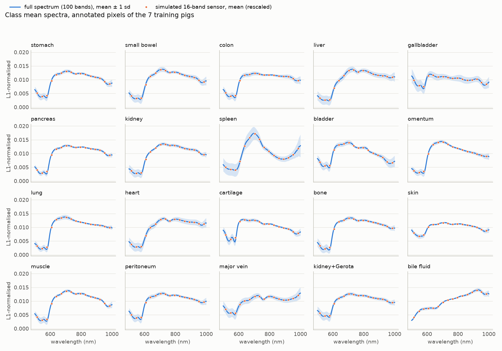
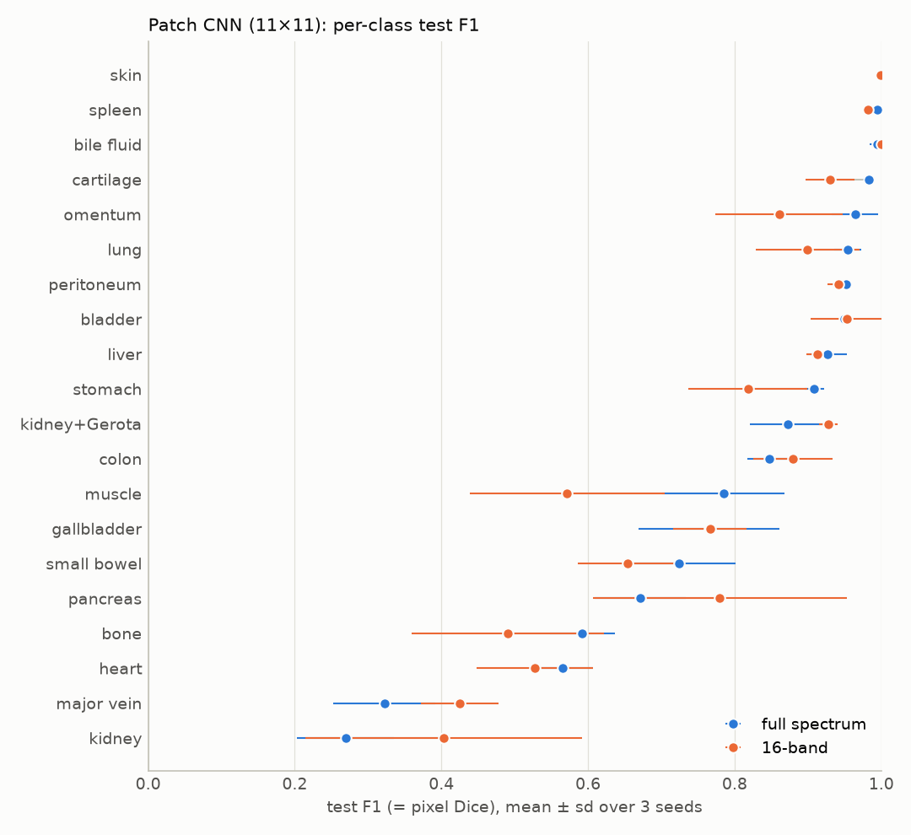

# Results

Generated by `scripts/evaluate.py`. Test pigs P095, P096 (128 images); metrics on annotated pixels only; mean ± sd over 3 seeds (0, 1, 2). Checkpoint = best validation macro F1 (val pigs P093, P094). Pixel Dice equals pixel F1 under this protocol, so it is reported once.

## Main table

| Model | Bands | Params | Test macro F1 | Test pixel acc. | Image-level acc. | Val macro F1 | Train time |
|---|---|---|---|---|---|---|---|
| Patch CNN (11×11) | full (100 bands) | 171k | **0.802 ± 0.008** | 0.887 ± 0.008 | 0.883 ± 0.000 | 0.896 ± 0.006 | 12.4 min |
| Patch CNN (11×11) | 16-band | 169k | **0.786 ± 0.011** | 0.859 ± 0.015 | 0.878 ± 0.016 | 0.896 ± 0.002 | 12.0 min |
| Pixel MLP | full (100 bands) | 40k | **0.751 ± 0.006** | 0.815 ± 0.003 | 0.888 ± 0.005 | 0.831 ± 0.002 | 2.6 min |
| Pixel MLP | 16-band | 29k | **0.713 ± 0.012** | 0.784 ± 0.008 | 0.865 ± 0.018 | 0.790 ± 0.003 | 2.0 min |
| U-Net | full (100 bands) | 458k | **0.761 ± 0.024** | 0.842 ± 0.027 | 0.859 ± 0.023 | 0.898 ± 0.007 | 22.4 min |
| U-Net | 16-band | 456k | **0.762 ± 0.009** | 0.848 ± 0.004 | 0.875 ± 0.008 | 0.897 ± 0.016 | 21.4 min |

Image-level accuracy: majority predicted class inside the annotated polygon equals the organ.

## Per-pig test macro F1

| Model | Bands | P095 | P096 |
|---|---|---|---|
| Patch CNN (11×11) | full (100 bands) | 0.833 ± 0.006 | 0.823 ± 0.019 |
| Patch CNN (11×11) | 16-band | 0.816 ± 0.024 | 0.808 ± 0.022 |
| Pixel MLP | full (100 bands) | 0.779 ± 0.005 | 0.748 ± 0.009 |
| Pixel MLP | 16-band | 0.751 ± 0.014 | 0.714 ± 0.007 |
| U-Net | full (100 bands) | 0.827 ± 0.025 | 0.784 ± 0.029 |
| U-Net | 16-band | 0.800 ± 0.021 | 0.793 ± 0.019 |

## Per-class test F1 (= pixel Dice), mean over seeds

| Class | Patch CNN (11×11) full | Patch CNN (11×11) snapshot16 | Pixel MLP full | Pixel MLP snapshot16 | U-Net full | U-Net snapshot16 |
|---|---|---|---|---|---|---|
| stomach | 0.91 | 0.82 | 0.76 | 0.72 | 0.76 | 0.78 |
| small bowel | 0.72 | 0.65 | 0.64 | 0.64 | 0.82 | 0.71 |
| colon | 0.85 | 0.88 | 0.70 | 0.67 | 0.67 | 0.79 |
| liver | 0.93 | 0.91 | 0.90 | 0.88 | 0.89 | 0.92 |
| gallbladder | 0.77 | 0.77 | 0.69 | 0.60 | 0.78 | 0.78 |
| pancreas | 0.67 | 0.78 | 0.59 | 0.55 | 0.53 | 0.69 |
| kidney | 0.27 | 0.40 | 0.28 | 0.26 | 0.09 | 0.44 |
| spleen | 1.00 | 0.98 | 0.98 | 0.98 | 0.99 | 1.00 |
| bladder | 0.95 | 0.95 | 0.92 | 0.90 | 0.91 | 0.85 |
| omentum | 0.96 | 0.86 | 0.94 | 0.92 | 0.94 | 0.94 |
| lung | 0.95 | 0.90 | 0.86 | 0.87 | 0.97 | 0.92 |
| heart | 0.57 | 0.53 | 0.50 | 0.45 | 0.68 | 0.60 |
| cartilage | 0.98 | 0.93 | 0.92 | 0.88 | 0.91 | 0.91 |
| bone | 0.59 | 0.49 | 0.57 | 0.47 | 0.55 | 0.49 |
| skin | 1.00 | 1.00 | 1.00 | 1.00 | 1.00 | 1.00 |
| muscle | 0.78 | 0.57 | 0.68 | 0.50 | 0.57 | 0.59 |
| peritoneum | 0.95 | 0.94 | 0.84 | 0.77 | 0.88 | 0.84 |
| major vein | 0.32 | 0.42 | 0.48 | 0.40 | 0.34 | 0.05 |
| kidney+Gerota | 0.87 | 0.93 | 0.77 | 0.80 | 0.96 | 0.96 |
| bile fluid | 0.99 | 1.00 | 1.00 | 1.00 | 1.00 | 0.97 |

## Most frequent confusions (test, 3 seeds pooled; fraction of the true class's pixels)

- **Patch CNN (11×11), full (100 bands):** major vein → bone 0.76; kidney → liver 0.56; heart → small bowel 0.22; kidney → heart 0.18; gallbladder → stomach 0.16
- **Patch CNN (11×11), 16-band:** kidney → liver 0.56; major vein → bone 0.37; major vein → cartilage 0.28; small bowel → muscle 0.24; gallbladder → stomach 0.23
- **Pixel MLP, full (100 bands):** kidney → heart 0.42; kidney → liver 0.31; major vein → cartilage 0.29; gallbladder → stomach 0.24; major vein → bone 0.22
- **Pixel MLP, 16-band:** kidney → heart 0.38; kidney → liver 0.37; major vein → cartilage 0.36; gallbladder → stomach 0.32; major vein → bone 0.19
- **U-Net, full (100 bands):** kidney → liver 0.94; major vein → bone 0.46; colon → pancreas 0.28; stomach → muscle 0.27; major vein → cartilage 0.22
- **U-Net, 16-band:** major vein → bone 0.76; kidney → liver 0.55; major vein → cartilage 0.21; stomach → muscle 0.19; heart → small bowel 0.17

## Figures

- [Confusion matrix: Patch CNN (11×11), full (100 bands)](figures/confusion_patch_cnn_full.png)
- [Confusion matrix: Patch CNN (11×11), 16-band](figures/confusion_patch_cnn_snapshot16.png)
- [Confusion matrix: Pixel MLP, full (100 bands)](figures/confusion_pixel_mlp_full.png)
- [Confusion matrix: Pixel MLP, 16-band](figures/confusion_pixel_mlp_snapshot16.png)
- [Confusion matrix: U-Net, full (100 bands)](figures/confusion_unet_full.png)
- [Confusion matrix: U-Net, 16-band](figures/confusion_unet_snapshot16.png)

## Analysis

All numbers below come from the tables above; nothing is from external sources.

**1. Test is clearly worse than validation.** Test macro F1 is 0.713–0.802, against 0.790–0.898
on validation. Part of this gap is optimism: the checkpoint was chosen on validation. The rest
is variation between pigs. Each split has only 2 pigs, and **8 of the 20 classes occur in only
one test pig (4 images)**, so per-class test F1 for those classes is a small-sample estimate.

**2. The two worst test classes fail because of a pig, not because the class is hard.**
- **Kidney** (test F1 0.09–0.44) occurs only in P096. On the validation pigs, kidney F1 was
  0.75–0.83 for every model. Most errors go to *liver* (0.31–0.94 of kidney pixels, depending
  on the model) and *heart*. The training-set mean spectra of kidney and liver are similar
  (see the figure).
- **Major vein** (test F1 0.05–0.48) occurs only in P095. Validation F1 was 0.81–0.97. It is
  mostly predicted as *bone* or *cartilage*.

We did not investigate the cause further, for example perfusion or the imaging conditions of
these recordings. With a single test pig per class, these results cannot separate "hard class"
from "unusual pig".

**3. 16 bands cost little once spatial context is used.**
- **Patch CNN:** −0.016 macro F1 (0.802 → 0.786). The two sd bands (±0.008 and ±0.011) do not
  overlap.
- **U-Net:** no measurable difference (0.761 vs 0.762).
- **Pixel MLP:** −0.038 (0.751 → 0.713). It has no spatial context, so it relies entirely on
  spectral detail.

The 16-band means track the 100-band class means closely (figure), which is consistent with
this. Per class, the 16-band patch CNN loses most on *muscle* (0.78 → 0.57) and *omentum*
(0.96 → 0.86), and gains on *kidney*, *major vein* and *pancreas*. All of these move by
amounts comparable to their seed sd.

**4. Model ranking on test: patch CNN > U-Net ≈ pixel MLP (full spectrum).** U-Net and patch CNN
were tied on validation. On test the U-Net is worse and less stable (full spectrum ±0.024).
Its best epoch was 38–40 of 40 in every run, so it is probably undertrained. We did not run a
longer schedule, so this is a hypothesis, not a result.

**5. Image-level accuracy is similar for all models (0.86–0.89).** A majority vote over each
annotated polygon removes most pixel-level noise. Even the per-pixel MLP identifies the organ
in 0.888 ± 0.005 of test images (full spectrum). The pixel-level differences between models
come mostly from boundary pixels and the hard classes above.

**Limitations of this evaluation:** 2 test pigs and 128 images; porcine organs imaged ex situ
or in an open-abdomen setting, not real surgical scenes; one organ labelled per image, so
background and organ boundaries are never scored; no hyperparameter search (one configuration
per model); simulated 16-band sensor (spectral binning only, no mosaic pattern or sensor
noise).
